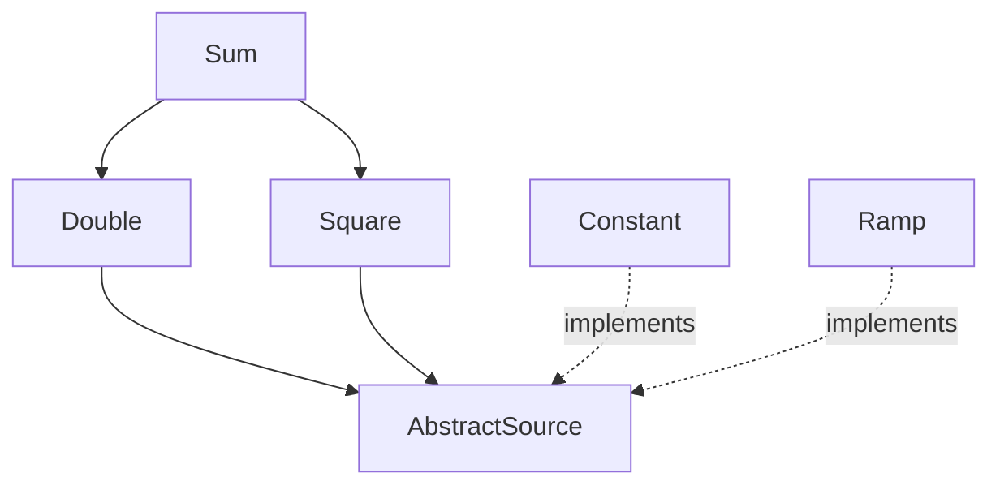

# Composition by closure

!!! note "Origin"
    This chapter, including the prototype code in `examples/composition`, was written by Claude Opus 5.5 (Anthropic) at the request of Johan Hidding, on 2026-11-03.

This page is a stand-alone prototype of the design discussed in [issue #14](https://github.com/jhidding/ModuleMixins.jl/issues/14). It doesn't use `@compose` at all. The question it tries to answer: can we keep what `@compose` is good at (diamond inheritance and automatically including all transitive dependencies), while composing values out of parts that Julia can dispatch on, instead of merging structs by name?

The prototype has three ingredients:

1. A **component** is an ordinary type (here, each component module defines an `Input` struct). A component declares what it depends on by extending `requires`. A dependency is either another component (a concrete type) or a **role** (an abstract type), which any component subtyping it can fill.
2. A **closure** computation walks those declarations, resolves roles, and returns every needed component exactly once, dependencies first. This is the part of `@compose` that handles the diamond.
3. A **`Composite`** holds one part per component. Property access is forwarded to the part that owns the field, so code can keep writing `input.t_step`, but each part keeps its own type for dispatch.

No macros are needed: the closure is computed by an ordinary function, and the composed type is just `Composite{Tuple{...}}`.

## Implementation

!!! details "examples/composition/composition.jl"

    ```julia
    #| file: examples/composition/composition.jl
    module Composition

    export requires, default_implementation, closure, model_type,
        Composite, parts, component, map_components

    <<composition-requires>>
    <<composition-closure>>
    <<composition-composite>>
    <<composition-component>>
    <<composition-construct>>

    end
    ```

### Requirements and roles

By default a component has no dependencies. Components with dependencies extend `requires`. A role may name a default implementation, used when nothing else fills it.

```julia
#| id: composition-requires
"""
    requires(T::Type)

The components (concrete types) or roles (abstract types) that component `T`
depends on. Extend this for every component that has dependencies.
"""
requires(::Type) = ()

"""
    default_implementation(R::Type)

The component used to fill role `R` if no component implementing `R` is
selected explicitly.
"""
default_implementation(R::Type) =
    error("no component implementing role $(R) was selected, and there is no default")
```

### Closure

`closure` does a depth-first walk from the selected components, appending each component after its dependencies, so that every component appears once. Roles are resolved first: a component selected explicitly takes precedence over the default implementation. Selecting two implementations of the same role is an error, and so is a cycle.

```julia
#| id: composition-closure
"""
    closure(roots::Type...)

Compute all components needed by `roots`, in dependency order (dependencies
first), each component appearing once. Abstract requirements (roles) are
resolved to a component implementing them: one of the `roots` if any, otherwise
`default_implementation`.
"""
function closure(roots::Type...)
    order = Type[]
    visiting = Type[]

    function resolve(R)
        isabstracttype(R) || return R
        candidates = [C for C in roots if C <: R]
        length(candidates) > 1 &&
            error("role $(R) is implemented by more than one component: $(candidates)")
        isempty(candidates) || return only(candidates)
        return default_implementation(R)
    end

    function visit(T)
        C = resolve(T)
        C in order && return
        C in visiting && error("cyclic requirement: $(join([visiting; C], " -> "))")
        push!(visiting, C)
        foreach(visit, requires(C))
        pop!(visiting)
        push!(order, C)
    end

    foreach(visit, roots)
    return Tuple(order)
end
```

### Composite values

A `Composite` wraps a tuple of parts. Property access is forwarded to the part that has a field of that name. The lookup is done in a generated function, so for a constant property name it resolves at compile time and `input.t_step` is as fast as a field access.

```julia
#| id: composition-composite
"""
    Composite{T <: Tuple}

A value composed of parts, one per component. Properties are forwarded to the
part that has a field of that name, so `c.x` works for any field `x` of any
part.
"""
struct Composite{T <: Tuple}
    parts::T
end

parts(c::Composite) = getfield(c, :parts)

# Index of the part that owns field `name`. Computed at compile time.
@generated function _owner(::Type{T}, ::Val{name}) where {T <: Tuple, name}
    i = findfirst(P -> hasfield(P, name), fieldtypes(T))
    i === nothing ? :(error("no component has a field `$(name)`")) : i
end

Base.getproperty(c::Composite, name::Symbol) =
    getfield(parts(c)[_owner(typeof(parts(c)), Val(name))], name)

Base.setproperty!(c::Composite, name::Symbol, value) =
    setproperty!(parts(c)[_owner(typeof(parts(c)), Val(name))], name, value)

Base.propertynames(c::Composite) = Tuple(Iterators.flatten(fieldnames.(typeof.(parts(c)))))

function Base.show(io::IO, c::Composite)
    print(io, "Composite(")
    join(io, parts(c), ", ")
    print(io, ")")
end
```

A component reaches its dependencies through `component`, which looks up a part by its type or by the role it implements. This is where dispatch comes in: the part that comes back has its own concrete type.

```julia
#| id: composition-component
# Index of the part that is (or implements) `T`. Computed at compile time.
@generated function _index(::Type{P}, ::Type{T}) where {P <: Tuple, T}
    i = findfirst(X -> X <: T, fieldtypes(P))
    i === nothing ? :(error("no component of type $(T)")) : i
end

"""
    component(c::Composite, T)

The part of `c` that is of type `T`, or that implements role `T`.
"""
component(c::Composite, ::Type{T}) where {T} = parts(c)[_index(typeof(parts(c)), T)]

"""
    map_components(f, c::Composite)

Apply `f` to every part of `c` and compose the results that aren't `nothing`.
"""
map_components(f, c::Composite) = Composite(Tuple(filter(!isnothing, map(f, parts(c)))))
```

### Construction

Users shouldn't need to know how a model is split into parts, so a composite is constructed from flat keyword arguments. Each argument is routed to the part that has a field of that name, and unknown arguments are an error. `model_type` computes the closure and checks that no field name is defined by two components, since forwarding would be ambiguous otherwise.

```julia
#| id: composition-construct
"""
    Composite{T}(; kwargs...)

Construct a composite from flat keyword arguments. Each keyword goes to the
part that has a field of that name.
"""
function (::Type{Composite{T}})(; kwargs...) where {T <: Tuple}
    types = fieldtypes(T)
    known = Set(Iterators.flatten(fieldnames.(types)))
    unknown = setdiff(keys(kwargs), known)
    isempty(unknown) || error("unknown arguments: $(join(unknown, ", "))")
    return Composite{T}(map(types) do P
        P(; (k => v for (k, v) in kwargs if hasfield(P, k))...)
    end)
end

"""
    model_type(roots::Type...)

The `Composite` type for the closure of `roots`.
"""
function model_type(roots::Type...)
    components = closure(roots...)
    names = collect(Iterators.flatten(fieldnames.(components)))
    duplicate = [n for n in unique(names) if count(==(n), names) > 1]
    isempty(duplicate) || error("field names defined by more than one component: $(duplicate)")
    return Composite{Tuple{components...}}
end
```

## An elemental example

A small diamond: `Double` and `Square` both depend on a source of a value, and `Sum` depends on both. The source is a role, `AbstractSource`, with two implementations, `Constant` (the default) and `Ramp`. Every component has a `value` method that dispatches on its own type.



```julia
#| file: examples/composition/elemental.jl
include("composition.jl")
using .Composition
import .Composition: requires, default_implementation
using Test

<<elemental-components>>
<<elemental-run>>
```

The role is an abstract type, and `value` is the function every component implements.

```julia
#| id: elemental-components
abstract type AbstractSource end
function value end

module Constant
    import ..AbstractSource, ..value
    @kwdef struct Input <: AbstractSource
        c::Float64 = 1.0
    end
    value(s::Input, model) = s.c
end

module Ramp
    import ..AbstractSource, ..value
    @kwdef struct Input <: AbstractSource
        slope::Float64 = 1.0
        x::Float64 = 0.0
    end
    value(s::Input, model) = s.slope * s.x
end

default_implementation(::Type{AbstractSource}) = Constant.Input
```

`Double` and `Square` require the role, not a specific implementation, and find it with `component`.

```julia
#| id: elemental-components
module Double
    import ..AbstractSource, ..value, ..requires
    using ..Composition: component
    @kwdef struct Input
        factor::Float64 = 2.0
    end
    requires(::Type{Input}) = (AbstractSource,)
    value(d::Input, model) = d.factor * value(component(model, AbstractSource), model)
end

module Square
    import ..AbstractSource, ..value, ..requires
    using ..Composition: component
    struct Input end
    requires(::Type{Input}) = (AbstractSource,)
    value(::Input, model) = value(component(model, AbstractSource), model)^2
end

module Sum
    import ..value, ..requires
    using ..Composition: component
    import ..Double, ..Square
    struct Input end
    requires(::Type{Input}) = (Double.Input, Square.Input)
    value(::Input, model) =
        value(component(model, Double.Input), model) +
        value(component(model, Square.Input), model)
end
```

Selecting only `Sum` is enough: the closure includes the source once, even though two components require it.

```julia
#| id: elemental-run
@show closure(Sum.Input)

const Model = model_type(Sum.Input)
m = Model(c = 3.0, factor = 10.0)
@show m
@show m.c m.factor
@show value(component(m, Sum.Input), m)
```

```
closure(Sum.Input) = (Main.Constant.Input, Main.Double.Input, Main.Square.Input, Main.Sum.Input)
m = Composite(Main.Constant.Input(3.0), Main.Double.Input(10.0), Main.Square.Input(), Main.Sum.Input())
m.c = 3.0
m.factor = 10.0
value(component(m, Sum.Input), m) = 39.0
```

To substitute the source, select `Ramp` explicitly. Both branches of the diamond now share the `Ramp`: $2 \cdot 3 + 3^2 = 15$.

```julia
#| id: elemental-run
const RampModel = model_type(Sum.Input, Ramp.Input)
@show closure(Sum.Input, Ramp.Input)
r = RampModel(slope = 2.0, x = 1.5)
@show value(component(r, Sum.Input), r)
```

```
closure(Sum.Input, Ramp.Input) = (Main.Ramp.Input, Main.Double.Input, Main.Square.Input, Main.Sum.Input)
value(component(r, Sum.Input), r) = 15.0
```

Property access and the whole `value` computation are type-stable. Mistakes are caught when the model is built: an unknown argument, or two components filling the same role.

```julia
#| id: elemental-run
get_c(m) = m.c
get_slope(m) = m.slope
@inferred get_c(m)
@inferred get_slope(r)
@inferred value(component(r, Sum.Input), r)

@test_throws ErrorException Model(colour = :red)
@test_throws ErrorException model_type(Sum.Input, Ramp.Input, Constant.Input)
println("all checks passed")
```

## Porting the spring example

Here is the [spring example](@ref "Example") on top of `Composition`. The structure stays the same: a `Time` component, a `Spring` component that depends on it, and a model. The differences:

- `Spring` declares its dependency with `requires` instead of `@mixin`.
- `initial_state` and `step!` are generic functions that dispatch on the component (the first argument). The composite versions loop over the parts in dependency order, which replaces `@constructor` and the hand-written `Model.step!`.
- The model is a single line, `model_type(Spring.Input)`.

```julia
#| file: examples/composition/spring.jl
include("composition.jl")
using .Composition
import .Composition: requires
using Unitful
using CairoMakie

<<spring-common>>
<<spring-time>>
<<spring-spring>>
<<spring-damping>>
<<spring-run>>
```

The common module defines the two generic functions, with a no-op default for components that have no state or don't step.

```julia
#| id: spring-common
module Common
    using ..Composition: Composite, parts, map_components

    """
        initial_state(part, input)

    The initial state of a single component, or `nothing` if it has no state.
    """
    initial_state(part, input) = nothing
    initial_state(input::Composite) = map_components(p -> initial_state(p, input), input)

    """
        step!(part, input, state)

    Advance the state of a single component. Components step in dependency order.
    """
    step!(part, input, state) = nothing
    step!(input::Composite, state) = foreach(p -> step!(p, input, state), parts(input))

    export initial_state, step!
end
```

Each component now has its own `Input` and `State` types. Methods take the component's own part as first argument for dispatch, and the full composite `input` and `state` to reach other components' fields.

```julia
#| id: spring-time
module Time
    using Unitful
    import ..Common: initial_state, step!

    @kwdef struct Input
        t_step::typeof(1.0u"s")
        t_end::typeof(1.0u"s")
    end

    mutable struct State
        time::typeof(1.0u"s")
    end

    initial_state(::Input, input) = State(0.0u"s")
    step!(::Input, input, state) = (state.time += input.t_step)

    function run(input)
        s = initial_state(input)
        Channel() do ch
            while s.time < input.t_end
                step!(input, s)
                put!(ch, deepcopy(s))
            end
        end
    end
end
```

```julia
#| id: spring-spring
module Spring
    using Unitful
    import ..Common: initial_state, step!
    import ..requires
    import ..Time

    @kwdef struct Input
        spring_constant::typeof(1.0u"s^-2")
        initial_position::typeof(1.0u"m")
    end

    mutable struct State
        position::typeof(1.0u"m")
        velocity::typeof(1.0u"m/s")
    end

    requires(::Type{Input}) = (Time.Input,)

    initial_state(::Input, input) = State(input.initial_position, 0.0u"m/s")

    function step!(::Input, input, state)
        delta_v = -input.spring_constant * state.position
        state.position += state.velocity * input.t_step
        state.velocity += delta_v * input.t_step
    end
end
```

The original `Model.step!` stepped the spring before the time. Here the time steps first, because it is a dependency. The spring doesn't read the time, so the result is the same: running both versions gives identical positions.

### Extending from outside

A new component doesn't need anything from the namespaces of the components it builds on, other than the names it uses. `Damping` is written as if it lived in a separate package, referring to everything by absolute path. Selecting `Damping` pulls in `Spring`, and through it `Time`.

```julia
#| id: spring-damping
module Damping
    using Unitful
    import Main.Composition: requires
    import Main.Common: step!
    import Main.Spring

    @kwdef struct Input
        damping::typeof(1.0u"s^-1")
    end

    requires(::Type{Input}) = (Spring.Input,)

    step!(::Input, input, state) =
        (state.velocity -= input.damping * state.velocity * input.t_step)
end
```

```julia
#| id: spring-run
const Model = model_type(Spring.Input)
const DampedModel = model_type(Damping.Input)
@show closure(Damping.Input)

parameters = (
    t_step = 0.001u"s",
    t_end = 1.0u"s",
    spring_constant = 250.0u"s^-2",
    initial_position = 1.0u"m",
)

function plot_result()
    output = Time.run(Model(; parameters...)) |> collect
    damped = Time.run(DampedModel(; parameters..., damping = 3.0u"s^-1")) |> collect

    fig = Figure()
    ax = Axis(fig[1, 1]; xlabel = "time [s]", ylabel = "position [m]")
    for (label, run) in ["spring" => output, "damped spring" => damped]
        lines!(ax, [s.time for s in run] ./ u"s", [s.position for s in run] ./ u"m";
               label = label)
    end
    axislegend(ax)
    save("docs/src/fig/composition-spring.svg", fig)
end

plot_result()
```

```
closure(Damping.Input) = (Main.Time.Input, Main.Spring.Input, Main.Damping.Input)
```


## Compared to `@compose`

What stays the same:

- **Diamonds and transitive closure.** A model names only the components it needs directly, and shared dependencies appear once.
- **A flat user interface.** Models are still constructed with flat keyword arguments, and code still reads `input.t_step`.

What changes:

- **Components are types, not modules.** Each part keeps its own type, so behaviour is selected by dispatch instead of `@for_each` over module names.
- **Substitution through roles.** A component can depend on a role, and any component implementing it fills the role for every dependant at once (see #4).
- **No code generation from stored syntax.** There is no `Core.eval` of parent ASTs, and no copied `using` statements, so components can be defined anywhere (see #16).
- **Ordinary Julia tooling applies.** Struct definitions are written out where they are defined, so they can be found, documented and revised like any other struct.

Limitations of this prototype:

- **Field names must be unique across a model.** Forwarding needs to know which part owns a name. `model_type` checks this.
- **One role per component.** Roles are abstract types, so a component can implement only one. Traits would lift this restriction.
- **Dependency order is the only order.** `step!` runs components in dependency order. A model that needs a different order defines its own `step!`, as `@compose` models do now.
- **No per-item records.** Records that are composed per item, like CarboKitten's facies, would be vectors of composites. They aren't covered here.
