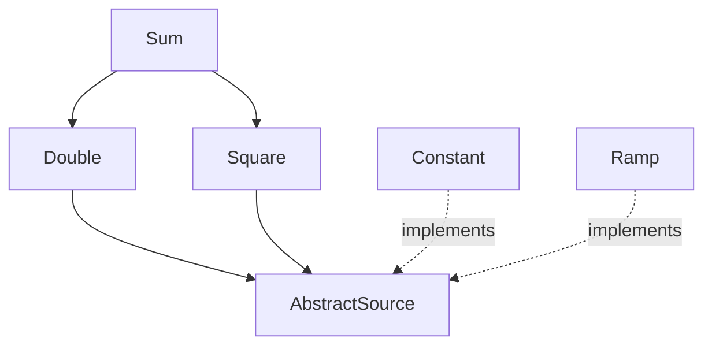
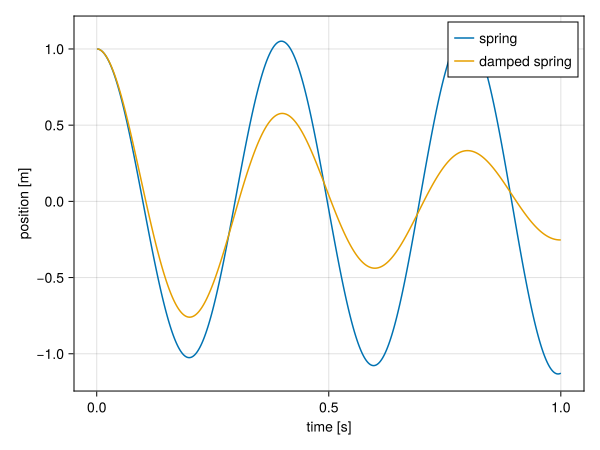

# Composition by closure

!!! note "Origin"
    This chapter, including the prototype code in `src/Components/Procedural.jl` and `examples/composition`, was written by Claude Opus 5.5 (Anthropic) at the request of Johan Hidding, on 2026-11-03 and 2026-11-04.

This page is a stand-alone prototype of the design discussed in [issue #14](https://github.com/jhidding/ModuleMixins.jl/issues/14). It doesn't use `@compose` at all. The question it tries to answer: can we keep what `@compose` is good at (diamond inheritance and automatically including all transitive dependencies), while composing values out of parts that Julia can dispatch on, instead of merging structs by name?

The prototype has three ingredients:

1. A **component** is a module. A component declares what it depends on by extending `requires`. A dependency is either another component (a module) or a **role** (an abstract type). A component fills a role by declaring it with `implements`. Both are traits on `Val{M}`, where `M` is the component module, so they can be declared anywhere.
2. A **closure** computation walks those declarations, resolves roles, and returns every needed component exactly once, dependencies first. This is the part of `@compose` that handles the diamond.
3. A **record** is composed of parts: every component that defines a struct of the record's name contributes that struct. A `Composite` holds one part per contributing component. Property access is forwarded to the part that owns the field, so code can keep writing `input.t_step`, but each part keeps its own type for dispatch.

No struct has a special place. By convention, the parameters of a model are in a record called `Input`, but a component can contribute to any number of records (`Input`, `State`, `Facies`, ...), and records can contain other records.

No macros are needed: the closure is computed by an ordinary function, and a record type is just a `Composite` of a tuple of part types. The next chapter adds an optional macro, [`@component`](@ref "Composition syntax"), to write components more concisely.

## Implementation

The library is the module `ModuleMixins.Procedural`.

!!! details "src/Components/Procedural.jl"

    ```julia
    #| file: src/Components/Procedural.jl
    module Procedural

    export requires, implements, default_implementation, closure,
        record_part, record_type, Composite, parts, component, map_components

    <<composition-requires>>
    <<composition-closure>>
    <<composition-composite>>
    <<composition-component>>
    <<composition-records>>

    end
    ```

### Requirements and roles

A component is identified by its module `M`. The traits dispatch on `Val{M}`, because methods can't dispatch on a module value directly. Inside a module, its own name is bound to the module, so a component declares its dependencies as `requires(::Val{Spring}) = (Time,)`. For convenience, `requires` and `implements` can also be called with a module.

By default a component has no dependencies and fills no roles. Roles are abstract types, but they only serve as names: nothing needs to subtype them. Since `implements` is a trait, a component can fill any number of roles, and the declaration can be made anywhere, for example to adapt a component from another package. A role may name a default implementation, used when nothing else fills it.

```julia
#| id: composition-requires
"""
    requires(::Val{M})

The components (modules) or roles (abstract types) that component `M`
depends on. Extend this for every component that has dependencies.
"""
requires(::Val) = ()
requires(M::Module) = requires(Val(M))

"""
    implements(::Val{M}, R::Type)

Whether component `M` fills role `R`. Defaults to `false`.
"""
implements(::Val, ::Type) = false
implements(M::Module, R::Type) = implements(Val(M), R)

"""
    default_implementation(R::Type)

The component (module) used to fill role `R` if no component implementing `R`
is selected explicitly.
"""
default_implementation(R::Type) =
    error("no component implementing role $(R) was selected, and there is no default")
```

### Closure

`closure` does a depth-first walk from the selected components, appending each component after its dependencies, so that every component appears once. Roles are resolved first: a component selected explicitly takes precedence over the default implementation. Selecting two implementations of the same role is an error, and so is a cycle.

```julia
#| id: composition-closure
"""
    resolve(R, roots)

The component that fills requirement `R`. A module is a component and resolves
to itself. A role resolves to the one component in `roots` that implements it,
or else to its `default_implementation`.
"""
resolve(M::Module, roots) = M

function resolve(R::Type, roots)
    candidates = [M for M in roots if implements(M, R)]
    length(candidates) > 1 &&
        error("role $(R) is implemented by more than one component: $(candidates)")
    isempty(candidates) || return only(candidates)
    return default_implementation(R)
end

resolve(x, roots) = error("requirement $(x) is neither a component (module) nor a role (type)")

"""
    closure(roots::Module...)

Compute all components needed by `roots`, in dependency order (dependencies
first), each component appearing once. Roles are resolved to a component
implementing them: one of the `roots` if any, otherwise `default_implementation`.
"""
function closure(roots::Module...)
    order = Module[]
    visiting = Module[]

    function visit(R)
        M = resolve(R, roots)
        M in order && return
        M in visiting && error("cyclic requirement: $(join([visiting; M], " -> "))")
        push!(visiting, M)
        foreach(visit, requires(M))
        pop!(visiting)
        push!(order, M)
    end

    foreach(visit, roots)
    return Tuple(order)
end
```

### Composite values

A `Composite` wraps a tuple of parts. Property access is forwarded to the part that has a field of that name. The lookup is done in a generated function, so for a constant property name it resolves at compile time and `input.t_step` is as fast as a field access.

The second type parameter records which part fills each role that a component in the model requires. It is a tuple of `RoleMap{R, i}` markers, meaning "role `R` is filled by part `i`". This is needed because role lookup also has to happen at compile time, but the generator of a `@generated` function may not call `implements`: methods added after the generator is defined, like the `implements` declarations of components, aren't reliably visible to it. So roles are resolved by `record_type`, which runs as ordinary code, and the generator only reads the result from the type. A composite built directly from parts, like the state composites below, has no roles.

```julia
#| id: composition-composite
"""
    RoleMap{R, i}

Marker type: role `R` is filled by part `i` of a composite.
"""
struct RoleMap{R, i} end

"""
    Composite{T <: Tuple, R <: Tuple}

A value composed of parts, one per component. Properties are forwarded to the
part that has a field of that name, so `c.x` works for any field `x` of any
part. `R` is a tuple of `RoleMap` markers, recording which part fills each role.
"""
struct Composite{T <: Tuple, R <: Tuple}
    parts::T
end

Composite(parts::Tuple) = Composite{typeof(parts), Tuple{}}(parts)

parts(c::Composite) = getfield(c, :parts)

# Index of the part that owns field `name`. Computed at compile time.
@generated function _owner(::Type{T}, ::Val{name}) where {T <: Tuple, name}
    i = findfirst(P -> hasfield(P, name), fieldtypes(T))
    i === nothing ? :(error("no component has a field `$(name)`")) : i
end

Base.getproperty(c::Composite, name::Symbol) =
    getfield(parts(c)[_owner(typeof(parts(c)), Val(name))], name)

Base.setproperty!(c::Composite, name::Symbol, value) =
    setproperty!(parts(c)[_owner(typeof(parts(c)), Val(name))], name, value)

Base.propertynames(c::Composite) = Tuple(Iterators.flatten(fieldnames.(typeof.(parts(c)))))

function Base.show(io::IO, c::Composite)
    print(io, "Composite(")
    join(io, parts(c), ", ")
    print(io, ")")
end
```

A component reaches its dependencies through `component`, which looks up a part by its component, by its type, or by the role its component implements. This is where dispatch comes in: the part that comes back has its own concrete type.

A part belongs to the module that defines its type, so the lookup by component only needs `parentmodule`, which is part of Julia and can be called at compile time. For that, the module has to be known at compile time, as a type parameter: `component(c, Val(Spring))`. Unlike symbols, modules are mutable objects, and Julia doesn't propagate them as constants into the functions they are passed to. So `component(c, Spring)` gives the right part, but its type isn't inferred. Inside a method, the type of the part is usually known as well, and `component(c, Spring.Input)` is type-stable too.

A part type is looked up by subtyping, so a parametric part like `FaciesBase.Input` is found without naming its type parameters. Roles are abstract types, and are looked up in the role map. Only a role that no component in the model requires falls back to calling `implements` at run time. That still gives the right part, but it isn't type-stable either.

```julia
#| id: composition-component
# Index of the part defined in module `M`. Computed at compile time.
@generated function _component_index(::Type{P}, ::Val{M}) where {P <: Tuple, M}
    i = findfirst(X -> parentmodule(X) === M, fieldtypes(P))
    i === nothing ? :(error("component $(M) has no part in this record")) : i
end

# Index of the part of type `T`, or that implements role `T`. Computed at
# compile time, except for roles that are not in the role map.
@generated function _type_index(::Type{P}, ::Type{R}, ::Type{T}) where {P <: Tuple, R <: Tuple, T}
    if isabstracttype(T)
        for m in fieldtypes(R)
            m.parameters[1] === T && return m.parameters[2]
        end
        return :(_role_index_dynamic(P, T))
    end
    i = findfirst(X -> X <: T, fieldtypes(P))
    i === nothing ? :(error("no part of type $(T) in this record")) : i
end

function _role_index_dynamic(::Type{P}, ::Type{T}) where {P <: Tuple, T}
    i = findfirst(X -> implements(parentmodule(X), T), fieldtypes(P))
    i === nothing && error("no part implementing role $(T)")
    return i
end

"""
    component(c::Composite, ::Val{M})
    component(c::Composite, M::Module)
    component(c::Composite, T::Type)

The part of `c` contributed by component `M`, the part of type `T`, or, if `T`
is a role (an abstract type), the part contributed by the component that
implements `T`. Pass a module as `Val(M)` for a type-stable lookup.
"""
component(c::Composite{P}, ::Val{M}) where {P, M} = parts(c)[_component_index(P, Val(M))]
component(c::Composite, M::Module) = component(c, Val(M))
component(c::Composite{P, R}, ::Type{T}) where {P, R, T} = parts(c)[_type_index(P, R, T)]
```

`map_components` applies a function to every part of a composite, and composes the results that aren't `nothing`. Typically, every component turns its part of one record into its part of another, say from `Input` to `State`. The results are dropped by recursion over the tuple, rather than with `filter`, so that the type of the new composite can be inferred.

The roles carry over: a role is filled by a component, so in the new composite, the role is filled by the part that comes from the same component, as `record_type` would have it. That part is found by the `parentmodule` of its type, so the new role map is computed at compile time as well. If no part of the result comes from that component, the role is dropped from the role map.

```julia
#| id: composition-component
_drop_nothing(::Tuple{}) = ()
_drop_nothing(t::Tuple) = _prepend(first(t), _drop_nothing(Base.tail(t)))
_prepend(::Nothing, t) = t
_prepend(x, t) = (x, t...)

# The role map `R` of parts `P`, carried over to new parts `Q`: each role is
# filled by the part of `Q` that comes from the same component. Computed at
# compile time.
@generated function _carry_roles(::Type{P}, ::Type{R}, ::Type{Q}) where {P <: Tuple, R <: Tuple, Q <: Tuple}
    maps = []
    for m in fieldtypes(R)
        role, i = m.parameters
        M = parentmodule(fieldtype(P, i))
        j = findfirst(X -> parentmodule(X) === M, fieldtypes(Q))
        j === nothing || push!(maps, RoleMap{role, j})
    end
    return Tuple{maps...}
end

"""
    map_components(f, c::Composite)

Apply `f` to every part of `c` and compose the results that aren't `nothing`.
A role of `c` is filled, in the result, by the part that comes from the same
component (module), if there is one.
"""
function map_components(f, c::Composite{P, R}) where {P, R}
    new_parts = _drop_nothing(map(f, parts(c)))
    Q = typeof(new_parts)
    return Composite{Q, _carry_roles(P, R, Q)}(new_parts)
end
```

### Records

A record is named by a symbol. Component `M` contributes to record `name` if it defines a type of that name: the binding `M.name` has to be a type whose `parentmodule` is `M`, so that a type imported from elsewhere doesn't count.

Records can contain other records. In CarboKitten, components contribute fields not only to the top-level input but also to each facies: `Production`, `CellularAutomaton` and `Denudation` each define a `Facies` struct. The part that holds the facies is then parametric, and its type parameter is named after the record it stands for:

```julia
@kwdef struct Input{Facies}
    facies::Vector{Facies} = []
end
```

Inside `Input`, `Facies` now stands for the composite of all `Facies` parts in the model. `record_type` builds that composite and substitutes it for the parameter. A record that (indirectly) contains itself is an error.

A part can also have type parameters that are not records. These are set by keyword arguments to `record_type`, and are matched by name. The typical use is storage: on a GPU, the arrays in a model's state have a different type than on the CPU, and a library like [Adapt](https://github.com/JuliaGPU/Adapt.jl) needs the field types to be parameters to convert between the two.

```julia
@kwdef struct State{Storage <: AbstractMatrix{Float64}}
    height::Storage
end

const CPUState = record_type(:State, Model; Storage = Matrix{Float64})
```

Components that use the same parameter name share one setting, so a single keyword switches the storage of a whole model. Every type parameter must either name a record, or be given as a keyword, so that a record type is always concrete. A parameter that does both is ambiguous and also an error. Keywords that no part uses are ignored, so the same keywords can be passed for every record of a model.

`record_type` computes the closure, resolves every role that a component in the model requires, and checks that no field name is defined by two parts of a record, since forwarding would be ambiguous otherwise.

```julia
#| id: composition-records
"""
    record_part(M::Module, name::Symbol)

The part that component `M` contributes to record `name`: the type `M.name`
if `M` defines it, otherwise `nothing`.
"""
function record_part(M::Module, name::Symbol)
    isdefined(M, name) || return nothing
    T = getfield(M, name)
    T isa Type && parentmodule(T) === M ? T : nothing
end

"""
    type_parameter_names(T)

The names of the type parameters of a `UnionAll` type, in order.
"""
function type_parameter_names(T)
    names = Symbol[]
    while T isa UnionAll
        push!(names, T.var.name)
        T = T.body
    end
    return names
end

function check_unique_fields(types)
    names = collect(Iterators.flatten(fieldnames.(types)))
    duplicate = [n for n in unique(names) if count(==(n), names) > 1]
    isempty(duplicate) || error("field names defined by more than one component: $(duplicate)")
end

"""
    record_type(name::Symbol, roots::Module...; parameters...)

The `Composite` type of record `name`, for the closure of `roots`. It has one
part for every component that defines a type `name`, in dependency order.

A type parameter of a part that is named after a record is filled with the
composite type of that record. Any other type parameter is taken from
`parameters`, by name.
"""
function record_type(name::Symbol, roots::Module...; parameters...)
    components = closure(roots...)
    roles = unique(R for M in components for R in requires(M) if R isa Type)
    resolved = [R => resolve(R, roots) for R in roles]
    return _record_type(name, components, resolved, NamedTuple(parameters), Symbol[])
end

is_record(name, components) = any(M -> record_part(M, name) !== nothing, components)

function _record_type(name, components, resolved, parameters, visiting)
    name in visiting && error("record $(name) contains itself: $(join([visiting; name], " -> "))")
    owners = [M for M in components if record_part(M, name) !== nothing]
    isempty(owners) && error("no component defines a record part `$(name)`")

    function parameter(P, n)
        record = is_record(n, components)
        given = haskey(parameters, n)
        record && given &&
            error("type parameter `$(n)` of $(P) names a record, and is also given as a keyword")
        record && return _record_type(n, components, resolved, parameters, visiting)
        given && return parameters[n]
        error("type parameter `$(n)` of $(P) is not a record, and is not given as a keyword to `record_type`")
    end

    push!(visiting, name)
    record_parts = map(owners) do M
        P = record_part(M, name)
        inner = type_parameter_names(P)
        isempty(inner) ? P : P{map(n -> parameter(P, n), inner)...}
    end
    pop!(visiting)

    check_unique_fields(record_parts)
    rolemap = [RoleMap{R, findfirst(==(M), owners)} for (R, M) in resolved if M in owners]
    return Composite{Tuple{record_parts...}, Tuple{rolemap...}}
end
```

Users shouldn't need to know how a record is split into parts, so a composite is constructed from flat keyword arguments. Each argument is routed to the part that has a field of that name, and unknown arguments are an error. Contained records are passed as named tuples of flat arguments: converting a named tuple to a composite type calls its keyword constructor, so a field `facies::Vector{Facies}` accepts a vector of named tuples.

```julia
#| id: composition-records
"""
    Composite{T, R}(; kwargs...)

Construct a composite from flat keyword arguments. Each keyword goes to the
part that has a field of that name.
"""
function (::Type{Composite{T, R}})(; kwargs...) where {T <: Tuple, R <: Tuple}
    types = fieldtypes(T)
    known = Set(Iterators.flatten(fieldnames.(types)))
    unknown = setdiff(keys(kwargs), known)
    isempty(unknown) || error("unknown arguments: $(join(unknown, ", "))")
    return Composite{T, R}(map(types) do P
        P(; (k => v for (k, v) in kwargs if hasfield(P, k))...)
    end)
end

Base.convert(::Type{C}, x::NamedTuple) where {C <: Composite} = C(; x...)
```

### Adapt

[Adapt](https://github.com/JuliaGPU/Adapt.jl) converts the storage of nested structures, for instance to move a model state to the GPU, or to turn arrays into device arrays when they are passed to a kernel. A composite is adapted by adapting each of its parts, with `map_components`. The result is again a composite, of a different type, and since every part stays with its component, with the same roles. Each part has to support Adapt itself, typically by `Adapt.@adapt_structure`. A part that doesn't is returned unchanged, as Adapt does by default.

This method lives in a package extension, so `ModuleMixins` doesn't depend on Adapt.

```julia
#| file: ext/ModuleMixinsAdaptExt.jl
module ModuleMixinsAdaptExt

using Adapt: Adapt, adapt
using ModuleMixins.Procedural: Composite, map_components

Adapt.adapt_structure(to, c::Composite) = map_components(p -> adapt(to, p), c)

end
```

### Tests

The tests use components `X`, `Y` and `Z`. `Y` requires roles `A` and `B`, which `X` both fills, and `Z` is the default for `A`. Components `Owner` and `Extra` both contribute to the record `Item`, which `Owner.Input` contains.

```julia
#| file: test/ProceduralSpec.jl
module ProceduralSpec
using Test
using ModuleMixins.Procedural
import ModuleMixins.Procedural: requires, implements, default_implementation

abstract type A end
abstract type B end
abstract type C end

module X
    @kwdef struct Input
        x::Int = 1
    end
    struct Output
        x2::Int
    end
end

module Y
    @kwdef struct Input
        y::Int = 2
    end
    struct Output
        y2::Int
    end
end

module Z
    @kwdef struct Input
        z::Int = 3
    end
end

module W
    using ..X: Input
end

requires(::Val{Y}) = (A, B)
implements(::Val{X}, ::Type{A}) = true
implements(::Val{X}, ::Type{B}) = true
implements(::Val{X}, ::Type{C}) = true
implements(::Val{Z}, ::Type{A}) = true
default_implementation(::Type{A}) = Z

@testset "Procedural" begin
    @test implements(X, A)
    @test implements(X, B)
    @test !implements(Z, B)

    @test closure(Y, X) == (X, Y)
    @test_throws ErrorException closure(Y)  # no default for B
    @test_throws ErrorException closure(Y, X, Z)  # A filled twice

    @test record_part(X, :Input) === X.Input
    @test record_part(X, :State) === nothing
    @test record_part(W, :Input) === nothing  # imported, not defined

    M = record_type(:Input, Y, X)
    m = M(x = 10)
    @test m.x == 10 && m.y == 2
    @test component(m, A) === component(m, B) === component(m, X)
    @test (@inferred component(m, B)) isa X.Input
    @test (@inferred component(m, Val(Y))) isa Y.Input
    @test (@inferred component(m, Y.Input)) isa Y.Input
    @test component(m, Y) isa Y.Input

    # C is not required by any component, so it is found at run time
    @test component(m, C) isa X.Input

    @test_throws ErrorException M(w = 1)
    @test_throws ErrorException component(m, Z)
    @test_throws ErrorException record_type(:State, Y, X)
end

output(p::X.Input) = X.Output(2p.x)
output(p::Y.Input) = Y.Output(2p.y)

@testset "Procedural map_components" begin
    m = record_type(:Input, Y, X)(x = 10)
    o = @inferred map_components(output, m)
    @test o.x2 == 20 && o.y2 == 4
    @test (@inferred component(o, A)) isa X.Output
    @test (@inferred component(o, B)) isa X.Output

    # X contributes nothing, so its roles are dropped
    d = @inferred map_components(p -> p isa X.Input ? nothing : output(p), m)
    @test parts(d) == (Y.Output(4),)
    @test_throws ErrorException component(d, A)

    # roles follow the component, not the position
    s = map_components(p -> p isa X.Input ? Y.Output(0) : X.Output(1), m)
    @test component(s, A) === X.Output(1)
end

module Owner
    @kwdef struct Item
        name::String = ""
    end
    @kwdef struct Input{Item}
        items::Vector{Item} = []
    end
end

# contributes to `Item`, but not to `Input`
module Extra
    @kwdef struct Item
        weight::Float64 = 1.0
    end
end

module Loop
    struct Input{Input}
        x::Input
    end
end

requires(::Val{Extra}) = (Owner,)

@testset "Procedural records" begin
    M = record_type(:Input, Extra)
    m = M(items = [(name = "a", weight = 2.0), (name = "b",)])
    @test m.items[1].name == "a" && m.items[1].weight == 2.0
    @test m.items[2].weight == 1.0
    @test component(m.items[1], Extra) isa Extra.Item
    @test component(m, Owner) isa Owner.Input
    @test component(m, Owner.Input) isa Owner.Input
    @test_throws ErrorException component(m, Extra)
    @test (@inferred (m -> m.items[1].weight)(m)) == 2.0

    # without `Extra`, items have only the owner's part
    @test record_type(:Input, Owner)(items = [(name = "c",)]).items[1].name == "c"
    @test_throws ErrorException record_type(:Input, Owner)(items = [(weight = 1.0,)])

    @test_throws ErrorException record_type(:Input, Loop)
end
```

Components `Grid` and `Growth` both have a type parameter `Storage`, and `Grid` also contains a record. To test Adapt, we use an adaptor that converts `Float64` vectors to `Float32`.

```julia
#| file: test/ProceduralSpec.jl
module Grid
    @kwdef struct Cell
        label::String = ""
    end
    @kwdef struct State{Cell, Storage <: AbstractVector{<:AbstractFloat}}
        cells::Vector{Cell} = []
        height::Storage
    end
end

module Growth
    @kwdef struct Cell
        rate::Float64 = 0.0
    end
    @kwdef mutable struct State{Storage}
        growth::Storage
    end
end

requires(::Val{Growth}) = (Grid,)

module Clash
    @kwdef struct State{Storage}
        x::Storage
    end
    struct Storage end
end

using Adapt

Adapt.@adapt_structure Grid.State
Adapt.@adapt_structure Growth.State

struct ToFloat32 end
Adapt.adapt_storage(::ToFloat32, x::Vector{Float64}) = Float32.(x)

@testset "Procedural type parameters" begin
    S = record_type(:State, Growth; Storage = Vector{Float64}, Unused = Int)
    @test isconcretetype(S)
    s = S(cells = [(label = "a", rate = 1.0)], height = [1.0, 2.0], growth = [0.5, 0.5])
    @test s.height isa Vector{Float64}
    @test s.cells[1].rate == 1.0
    @test (@inferred (s -> s.height[2])(s)) == 2.0

    @test_throws ErrorException record_type(:State, Growth)  # Storage not given
    @test_throws TypeError record_type(:State, Growth; Storage = Vector{Int})  # violates bound
    @test_throws ErrorException record_type(:State, Clash; Storage = Int)  # record and keyword

    t = adapt(ToFloat32(), s)
    @test t.height isa Vector{Float32} && t.growth == Float32[0.5, 0.5]
    @test t.cells == s.cells
    @test component(t, Growth) isa Growth.State{Vector{Float32}}
end
end
```

## An elemental example

A small diamond: `Double` and `Square` both depend on a source of a value, and `Sum` depends on both. The source is a role, `AbstractSource`, with two implementations, `Constant` (the default) and `Ramp`. Every component has a `value` method that dispatches on the type of its own part.



```julia
#| file: examples/composition/elemental.jl
using ModuleMixins.Procedural
import ModuleMixins.Procedural: requires, implements, default_implementation
using Test

<<elemental-components>>
<<elemental-run>>
```

The role is an abstract type, and `value` is the function every component implements.

```julia
#| id: elemental-components
abstract type AbstractSource end
function value end

module Constant
    import ..AbstractSource, ..value, ..implements
    @kwdef struct Input
        c::Float64 = 1.0
    end
    implements(::Val{Constant}, ::Type{AbstractSource}) = true
    value(s::Input, model) = s.c
end

module Ramp
    import ..AbstractSource, ..value, ..implements
    @kwdef struct Input
        slope::Float64 = 1.0
        x::Float64 = 0.0
    end
    implements(::Val{Ramp}, ::Type{AbstractSource}) = true
    value(s::Input, model) = s.slope * s.x
end

default_implementation(::Type{AbstractSource}) = Constant
```

`Double` and `Square` require the role, not a specific implementation, and find it with `component`.

```julia
#| id: elemental-components
module Double
    import ..AbstractSource, ..value, ..requires
    using ModuleMixins.Procedural: component
    @kwdef struct Input
        factor::Float64 = 2.0
    end
    requires(::Val{Double}) = (AbstractSource,)
    value(d::Input, model) = d.factor * value(component(model, AbstractSource), model)
end

module Square
    import ..AbstractSource, ..value, ..requires
    using ModuleMixins.Procedural: component
    struct Input end
    requires(::Val{Square}) = (AbstractSource,)
    value(::Input, model) = value(component(model, AbstractSource), model)^2
end

module Sum
    import ..value, ..requires
    using ModuleMixins.Procedural: component
    import ..Double, ..Square
    struct Input end
    requires(::Val{Sum}) = (Double, Square)
    value(::Input, model) =
        value(component(model, Double.Input), model) +
        value(component(model, Square.Input), model)
end
```

Selecting only `Sum` is enough: the closure includes the source once, even though two components require it.

```julia
#| id: elemental-run
@show closure(Sum)

const Model = record_type(:Input, Sum)
m = Model(c = 3.0, factor = 10.0)
@show m
@show m.c m.factor
@show value(component(m, Sum.Input), m)
```

```
closure(Sum) = (Main.Constant, Main.Double, Main.Square, Main.Sum)
m = Composite(Main.Constant.Input(3.0), Main.Double.Input(10.0), Main.Square.Input(), Main.Sum.Input())
m.c = 3.0
m.factor = 10.0
value(component(m, Sum.Input), m) = 39.0
```

To substitute the source, select `Ramp` explicitly. Both branches of the diamond now share the `Ramp`: $2 \cdot 3 + 3^2 = 15$.

```julia
#| id: elemental-run
const RampModel = record_type(:Input, Sum, Ramp)
@show closure(Sum, Ramp)
r = RampModel(slope = 2.0, x = 1.5)
@show value(component(r, Sum.Input), r)
```

```
closure(Sum, Ramp) = (Main.Ramp, Main.Double, Main.Square, Main.Sum)
value(component(r, Sum.Input), r) = 15.0
```

Property access and the whole `value` computation are type-stable. Mistakes are caught when the model is built: an unknown argument, or two components filling the same role.

```julia
#| id: elemental-run
get_c(m) = m.c
get_slope(m) = m.slope
@inferred get_c(m)
@inferred get_slope(r)
@inferred value(component(r, Sum.Input), r)

@test_throws ErrorException Model(colour = :red)
@test_throws ErrorException record_type(:Input, Sum, Ramp, Constant)
```

### One component, two roles

A ramp also has a gradient. Suppose there is a second role, `AbstractGradient`, and a component `Slope` that reports the gradient of whatever fills that role. `Ramp` can fill this role as well. The declaration is made outside the `Ramp` module, as it would be if `Ramp` came from another package.

```julia
#| id: elemental-run
abstract type AbstractGradient end
function gradient end

gradient(s::Ramp.Input, model) = s.slope
implements(::Val{Ramp}, ::Type{AbstractGradient}) = true

module Slope
    import ..AbstractGradient, ..value, ..gradient, ..requires
    using ModuleMixins.Procedural: component
    struct Input end
    requires(::Val{Slope}) = (AbstractGradient,)
    value(::Input, model) = gradient(component(model, AbstractGradient), model)
end
```

Selecting `Ramp` once fills both roles, so `Sum` and `Slope` read from the same part. `AbstractGradient` has no default implementation, so a model that needs a gradient without selecting `Ramp` is an error.

```julia
#| id: elemental-run
const BothModel = record_type(:Input, Sum, Slope, Ramp)
@show closure(Sum, Slope, Ramp)
b = BothModel(slope = 2.0, x = 1.5)
@show value(component(b, Sum.Input), b)
@show value(component(b, Slope.Input), b)
@test component(b, AbstractSource) === component(b, AbstractGradient)

@inferred value(component(b, Slope.Input), b)
@test_throws ErrorException record_type(:Input, Sum, Slope)
println("all checks passed")
```

```
closure(Sum, Slope, Ramp) = (Main.Ramp, Main.Double, Main.Square, Main.Sum, Main.Slope)
value(component(b, Sum.Input), b) = 15.0
value(component(b, Slope.Input), b) = 2.0
all checks passed
```

## Porting the spring example

Here is the [spring example](@ref "Example") on top of `Procedural`. The structure stays the same: a `Time` component, a `Spring` component that depends on it, and a model. The differences:

- `Spring` declares its dependency with `requires` instead of `@mixin`.
- `initial_state` and `step!` are generic functions that dispatch on the part (the first argument). The composite versions loop over the parts in dependency order, which replaces `@constructor` and the hand-written `Model.step!`.
- The model is a single line, `record_type(:Input, Spring)`.

```julia
#| file: examples/composition/spring.jl
using ModuleMixins.Procedural
import ModuleMixins.Procedural: requires
using Unitful
using CairoMakie

<<spring-common>>
<<spring-time>>
<<spring-spring>>
<<spring-damping>>
<<spring-run>>
```

The common module defines the two generic functions, with a no-op default for components that have no state or don't step.

```julia
#| id: spring-common
module Common
    using ModuleMixins.Procedural: Composite, parts, map_components

    """
        initial_state(part, input)

    The initial state of a single component, or `nothing` if it has no state.
    """
    initial_state(part, input) = nothing
    initial_state(input::Composite) = map_components(p -> initial_state(p, input), input)

    """
        step!(part, input, state)

    Advance the state of a single component. Components step in dependency order.
    """
    step!(part, input, state) = nothing
    step!(input::Composite, state) = foreach(p -> step!(p, input, state), parts(input))

    export initial_state, step!
end
```

Each component has its own `Input` and `State` types. Methods take the component's own part as first argument for dispatch, and the full composite `input` and `state` to reach other components' fields.

```julia
#| id: spring-time
module Time
    using Unitful
    import ..Common: initial_state, step!

    @kwdef struct Input
        t_step::typeof(1.0u"s")
        t_end::typeof(1.0u"s")
    end

    mutable struct State
        time::typeof(1.0u"s")
    end

    initial_state(::Input, input) = State(0.0u"s")
    step!(::Input, input, state) = (state.time += input.t_step)

    function run(input)
        s = initial_state(input)
        Channel() do ch
            while s.time < input.t_end
                step!(input, s)
                put!(ch, deepcopy(s))
            end
        end
    end
end
```

```julia
#| id: spring-spring
module Spring
    using Unitful
    import ..Common: initial_state, step!
    import ..requires
    import ..Time

    @kwdef struct Input
        spring_constant::typeof(1.0u"s^-2")
        initial_position::typeof(1.0u"m")
    end

    mutable struct State
        position::typeof(1.0u"m")
        velocity::typeof(1.0u"m/s")
    end

    requires(::Val{Spring}) = (Time,)

    initial_state(::Input, input) = State(input.initial_position, 0.0u"m/s")

    function step!(::Input, input, state)
        delta_v = -input.spring_constant * state.position
        state.position += state.velocity * input.t_step
        state.velocity += delta_v * input.t_step
    end
end
```

The original `Model.step!` stepped the spring before the time. Here the time steps first, because it is a dependency. The spring doesn't read the time, so the result is the same: running both versions gives identical positions.

### Extending from outside

A new component doesn't need anything from the namespaces of the components it builds on, other than the names it uses. `Damping` is written as if it lived in a separate package, referring to everything by absolute path. Selecting `Damping` pulls in `Spring`, and through it `Time`.

```julia
#| id: spring-damping
module Damping
    using Unitful
    import ModuleMixins.Procedural: requires
    import Main.Common: step!
    import Main.Spring

    @kwdef struct Input
        damping::typeof(1.0u"s^-1")
    end

    requires(::Val{Damping}) = (Spring,)

    step!(::Input, input, state) =
        (state.velocity -= input.damping * state.velocity * input.t_step)
end
```

```julia
#| id: spring-run
const Model = record_type(:Input, Spring)
const DampedModel = record_type(:Input, Damping)
@show closure(Damping)

parameters = (
    t_step = 0.001u"s",
    t_end = 1.0u"s",
    spring_constant = 250.0u"s^-2",
    initial_position = 1.0u"m",
)

function plot_result()
    output = Time.run(Model(; parameters...)) |> collect
    damped = Time.run(DampedModel(; parameters..., damping = 3.0u"s^-1")) |> collect

    fig = Figure()
    ax = Axis(fig[1, 1]; xlabel = "time [s]", ylabel = "position [m]")
    for (label, run) in ["spring" => output, "damped spring" => damped]
        lines!(ax, [s.time for s in run] ./ u"s", [s.position for s in run] ./ u"m";
               label = label)
    end
    axislegend(ax)
    save("docs/src/fig/composition-spring.svg", fig)
end

plot_result()
```

```
closure(Damping) = (Main.Time, Main.Spring, Main.Damping)
```



## Compared to `@compose`

What stays the same:

- **Components are modules.** As with `@compose`, a component is a module, and the structs it defines are merged with those of the same name in other components.
- **Diamonds and transitive closure.** A model names only the components it needs directly, and shared dependencies appear once.
- **A flat user interface.** Models are still constructed with flat keyword arguments, and code still reads `input.t_step`.

What changes:

- **Parts keep their types.** A record is not merged into a single struct: each part keeps its own type, so behaviour is selected by dispatch instead of `@for_each` over module names.
- **Substitution through roles.** A component can depend on a role, and any component implementing it fills the role for every dependant at once (see #4).
- **No code generation from stored syntax.** There is no `Core.eval` of parent ASTs, and no copied `using` statements, so components can be defined anywhere (see #16).
- **Ordinary Julia tooling applies.** Struct definitions are written out where they are defined, so they can be found, documented and revised like any other struct.

Limitations shared with `@compose`:

- **Field names must be unique across a record.** Forwarding needs to know which part owns a name, just as `@compose` needs it to merge fields. `record_type` checks this.
- **Dependency order is the only order.** `step!` runs components in dependency order. A model that needs a different order defines its own `step!`, as `@compose` models do now.

Both depend on which components end up in the model, so they can only be checked or resolved when the model is assembled.

## Design notes

### Roles as traits

An earlier version of this prototype used subtyping as the only way to fill a role. Since a Julia struct has one supertype, chosen where the struct is defined, a component could fill only one role. Now that a component is a module, rather than one of its structs, subtyping doesn't apply at all, and role membership is the trait `implements(::Val{M}, R)` (see [Requirements and roles](@ref)). It can be extended anywhere, and a component can fill any number of roles. The example [One component, two roles](@ref) shows it in use. Two consequences of this design:

- `implements` is user-extensible, so it can't be called from the generator of a `@generated` function. Roles are therefore resolved in `record_type` and stored in the composite type as a role map. A role that no component in the model requires is still found by `component`, but at run time.
- Methods can't dispatch on a role (`value(s::AbstractSource, model)` matches no part). Where that's needed, the usual Holy-trait pattern applies. In practice components find each other through `component(model, Role)`.

### Components as modules

An earlier version of this prototype identified a component by a type, its `Input` struct. That gave `Input` a special place: it was the component's identity, and the only record that could be composed at the top level. Other structs, like `Facies`, could only be composed as items inside an `Input`, through an extra protocol. Identifying a component by its module, as `@compose` does, removes both: all structs in a component are treated alike, and a record is any struct name that components share. The state of the spring example could be composed with `record_type(:State, Spring)` in the same way, though there `map_components` is more convenient, since each part of the state is computed from the input.

The cost is that a component is always a whole module, that roles can't be filled by subtyping, and that looking up a part by its module is only type-stable when the module is passed as `Val(M)` (see [Composite values](@ref)). The [`@component`](@ref "Composition syntax") macro of the next chapter makes components written this way more concise.
